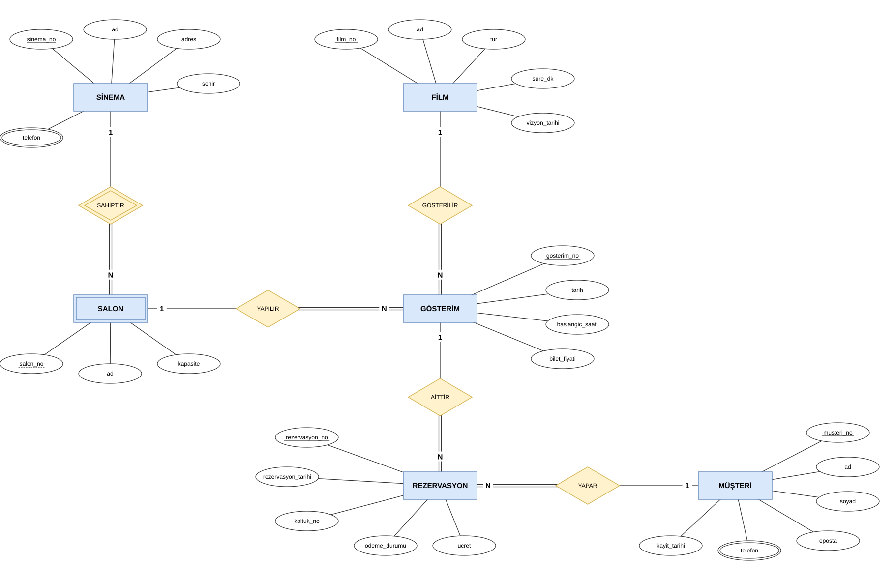

# Sinema Rezervasyon Sistemi

Veri Tabanı Yönetim Sistemleri dersi dönem projesi (Konu 21 - Sinema Rezervasyon Sistemi).

Proje bir MySQL veritabanı ve bu veritabanını kullanan bir web arayüzünden oluşuyor. Sinemalar, salonlar, filmler, gösterimler, müşteriler ve rezervasyonlar tutuluyor. Arayüzden koltuk seçilerek bilet satılabiliyor.

## Kullanılan Teknolojiler

- MySQL 8.0
- ASP.NET Core Razor Pages (.NET 5, C#)
- MySqlConnector (ORM kullanılmadı, tüm sorgular SQL olarak yazıldı)
- Bootstrap 4

## Konu Metni

> Sinemaların benzersiz bir numarası, adı, adresi ve birden fazla telefon numarası vardır. Her sinemada birden fazla salon bulunur ve her salonun benzersiz bir numarası, adı ve oturma kapasitesi vardır. Filmlerin benzersiz bir numarası, adı, türü, süresi ve gösterime giriş tarihi bulunur. Filmler sinema salonlarında gösterilir ve her gösterim için tarih, başlangıç saati ve bilet fiyatı kaydedilir. Müşterilerin benzersiz bir kimlik numarası, adı, soyadı, e-posta adresi ve birden fazla telefon numarası vardır. Müşteriler gösterimler için rezervasyon yapar. Her rezervasyonun benzersiz bir numarası, rezervasyon tarihi, koltuk numarası ve ödeme durumu bulunur.

## ER Diyagramı



Düzenlenebilir hali: `dokumanlar/er_diyagrami.drawio` (draw.io / diagrams.net ile açılabilir)

## İlişkisel Şema

- **sinema** (<u>sinema_no</u>, ad, adres, sehir)
- **sinema_telefon** (<u>sinema_no</u>, <u>telefon</u>)
- **salon** (<u>sinema_no</u>, <u>salon_no</u>, ad, kapasite)
- **film** (<u>film_no</u>, ad, tur, sure_dk, vizyon_tarihi)
- **gosterim** (<u>gosterim_no</u>, film_no, sinema_no, salon_no, tarih, baslangic_saati, bilet_fiyati)
- **musteri** (<u>musteri_no</u>, ad, soyad, eposta, kayit_tarihi)
- **musteri_telefon** (<u>musteri_no</u>, <u>telefon</u>)
- **rezervasyon** (<u>rezervasyon_no</u>, musteri_no, gosterim_no, rezervasyon_tarihi, koltuk_no, odeme_durumu, ucret)
- **rezervasyon_log** (<u>log_no</u>, rezervasyon_no, eski_durum, yeni_durum, islem_zamani)

Bazı tasarım kararları:

- Telefon numaraları çok değerli nitelik olduğu için ayrı tablolarda tutuluyor (1NF).
- Salon zayıf varlık olarak modellendi. Salon numarası her sinemada 1'den başlıyor, bu yüzden anahtar (sinema_no, salon_no).
- Gösterim aslında film ile salon arasındaki ilişki. Ama tarih, saat ve fiyat gibi kendi bilgileri olduğu ve rezervasyonlar ona bağlandığı için ayrı tablo yapıldı.
- `rezervasyon.ucret` bilet alındığı andaki fiyatı tutuyor. Gösterimin fiyatı sonradan değişirse eski satışlar etkilenmiyor.

Normalizasyon, kısıtlar ve tüm nesnelerin açıklaması için: [dokumanlar/iliskisel_sema.md](dokumanlar/iliskisel_sema.md)

## Veritabanı Nesneleri

**Triggerlar**

| Trigger | Görevi |
|---|---|
| `trg_gosterim_ekle` / `trg_gosterim_guncelle` | Aynı salonda saatleri çakışan gösterim eklenemez (film süresi + 15 dk temizlik). Film vizyona girmeden gösterim yapılamaz |
| `trg_rezervasyon_ekle` | Dolu koltuk tekrar satılamaz, kapasite dışı koltuk numarası girilemez, geçmiş seansa bilet satılamaz. Ücret gösterimden otomatik alınır |
| `trg_rezervasyon_guncelle` | İptal edilen rezervasyon tekrar aktif edilemez |
| `trg_rezervasyon_log_ekle` / `trg_rezervasyon_log_guncelle` | Ödeme durumu değişikliklerini `rezervasyon_log` tablosuna yazar |
| `trg_salon_kapasite` | Satılmış koltukların altına kapasite düşürülemez |

**Viewlar:** `v_gosterim_detay`, `v_rezervasyon_detay`, `v_film_hasilat`, `v_musteri_ozet`, `v_sinema_ozet`

**Stored Procedure'ler:** `sp_rezervasyon_yap` (transaction ile), `sp_odeme_al`, `sp_rezervasyon_iptal`, `sp_tarih_araligi_rapor`

**Fonksiyonlar:** `fn_bos_koltuk`, `fn_salon_dolu_mu`

## Kurulum

### 1. Veritabanı

`veritabani/sinema_db.sql` dosyası her şeyi tek seferde kuruyor (tablolar, trigger, view, prosedür, örnek veriler).

MySQL Workbench'te dosyayı açıp çalıştırmak yeterli. Komut satırından:

```
mysql -u root -p < veritabani/sinema_db.sql
```

Windows'ta `veritabani/kur.bat` dosyasına çift tıklayarak da kurulabilir.

Script, web uygulamasının bağlandığı `sinema_app` kullanıcısını da oluşturuyor. Şifre değiştirilecekse `appsettings.json` içindeki bağlantı cümlesi de güncellenmeli.

Örnek verilerdeki gösterim tarihleri kurulum gününe göre hesaplanıyor, bu yüzden hangi gün kurulursa kurulsun gösterimler ileri tarihte oluyor.

### 2. Web Arayüzü

.NET 5 SDK gerekli.

```
cd web/SinemaApp
dotnet run
```

Sonra tarayıcıdan `http://localhost:5000` adresine girilir.

## Arayüz Sayfaları

| Sayfa | Açıklama |
|---|---|
| Ana Sayfa | Özet bilgiler, yaklaşan gösterimler, son rezervasyonlar |
| Gösterimler | Tarih / sinema / film filtresi, doluluk oranı, gösterim ekleme |
| Bilet Satışı | Koltuk haritasından koltuk seçip rezervasyon yapma |
| Rezervasyonlar | Ödeme alma, iptal etme |
| Filmler | Film ekleme, düzenleme, silme |
| Sinemalar | Sinema bilgileri, telefonlar, salonlar |
| Müşteriler | Müşteri bilgileri, telefonlar, rezervasyon geçmişi |
| Raporlar | Film ve sinema hasılatı, günlük satış raporu, son işlemler |

Trigger veya kısıt bir işlemi engellediğinde veritabanından gelen hata mesajı ekranda gösteriliyor (örneğin dolu koltuğu satmaya çalışınca).

## Klasör Yapısı

```
veritabani/
    sinema_db.sql        tüm kurulum
    test_sorgulari.sql   view, prosedür ve trigger denemeleri
    kur.bat
dokumanlar/
    er_diyagrami.drawio
    er_diyagrami.svg
    iliskisel_sema.md
web/SinemaApp/           web arayüzü
```

## Test

`veritabani/test_sorgulari.sql` içinde view'ların ve prosedürlerin çıktıları ile trigger'ları bilerek hataya düşüren sorgular var (dolu koltuk, salon çakışması, vizyon tarihinden önce gösterim vb.). Sorgular Workbench'te tek tek çalıştırılarak denenebilir.
